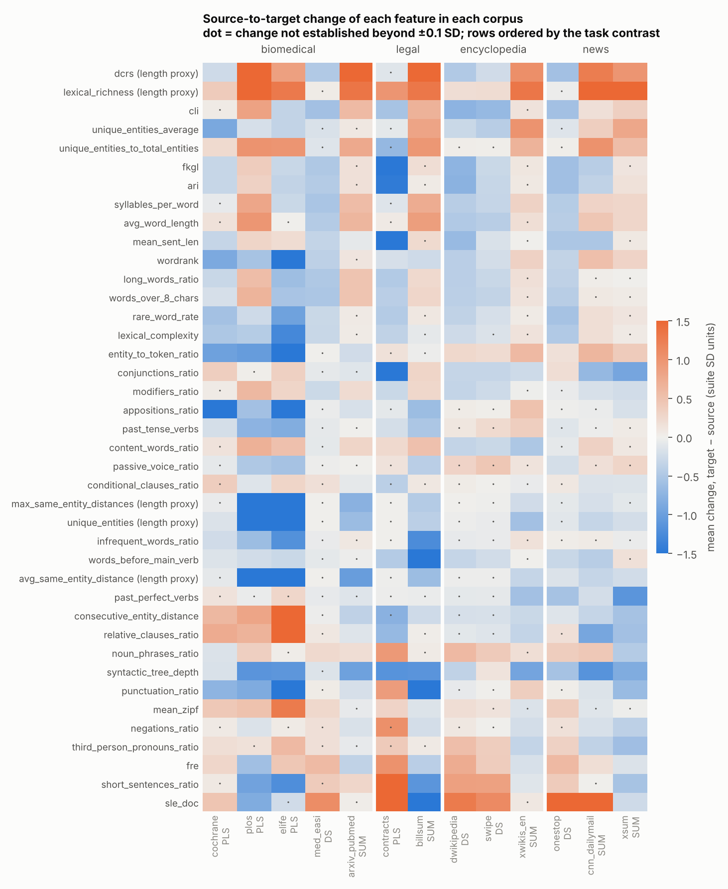
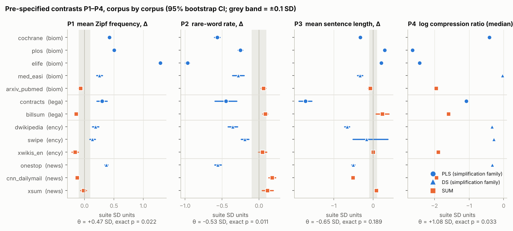
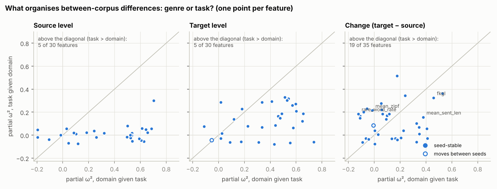
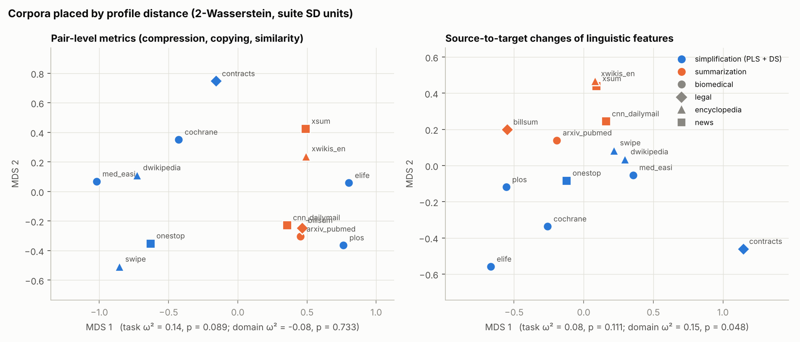
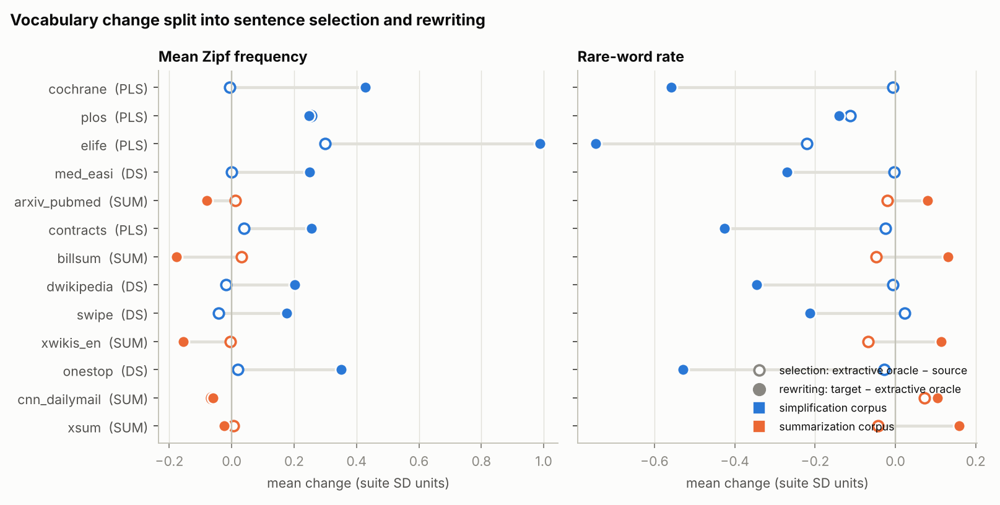

# Cross-corpus comparison: tables

Generated by `python -m analysis.run` (seed 13, 1000 resampling repeats per distance matrix, 4999 domain permutations, 2000 bootstrap replicates). Plan: `docs/analysis-plan.md`. Interpretation: `analysis/FINDINGS.md`. No metric was recomputed: the inputs are the existing `per_pair.parquet` files.

## 1. Data and gates

- Runs read: 26 of 26 expected run directories present (15 base, 11 later).
- Reproduction gate: 264 of 264 checks pass (mean, median and n recomputed from per-pair rows against the statistics written by the same run; sources: results).
- Base vs later runs: 1089 of 1089 analysed columns shared by both runs are identical on every shared pair.
- Identities: max |coverage + novel_1gram − 1| = 0.0e+00; M7 copies of M3 differ by at most 0.0e+00.
- Within-domain relabelings for the two-family test: 90 (smallest attainable p = 0.011).

| corpus | task | domain | pairs | base sample | later-run sample | base run |
|---|---|---|---|---|---|---|
| cochrane | PLS | biomedical | 1000 | 250 | 250 | cochrane_20261009T203350Z |
| plos | PLS | biomedical | 1000 | 60 | 60 | plos_20261009T213055Z |
| elife | PLS | biomedical | 1000 | 60 | 0 | elife_20261009T231209Z |
| med_easi | DS | biomedical | 1000 | 250 | 250 | med_easi_20261009T203240Z |
| arxiv_pubmed | SUM | biomedical | 1000 | 250 | 0 | arxiv_pubmed_20261009T204333Z |
| contracts | PLS | legal | 446 | 250 | 250 | contracts_20261009T184140Z |
| billsum | SUM | legal | 1000 | 250 | 250 | billsum_20261009T184300Z |
| dwikipedia | DS | encyclopedia | 1000 | 250 | 250 | dwikipedia_20261009T183428Z |
| swipe | DS | encyclopedia | 1000 | 250 | 250 | swipe_20261009T183808Z |
| xwikis_en | SUM | encyclopedia | 1000 | 250 | 250 | xwikis_en_20261009T175938Z |
| onestop | DS | news | 189 | 189 | 0 | onestop_20261009T160136Z |
| cnn_dailymail | SUM | news | 1000 | 250 | 250 | cnn_dailymail_20261009T174746Z |
| xsum | SUM | news | 1000 | 250 | 250 | xsum_20261009T174114Z |
| swipe_gold | – | – | 1000 | 250 | 250 | swipe_gold_20261009T183033Z |
| ukabs | – | – | 589 | 0 | 0 | ukabs_20261009T190757Z |

## 2. Metric structure

Redundancy families (mean within-corpus |ρ| ≥ 0.8) with more than one member; the first metric in registry order represents the family in multi-metric summaries:

| representative | members |
|---|---|
| avg_same_entity_distance | avg_same_entity_distance, max_same_entity_distances |
| cli | cli, syllables_per_word, avg_word_length |
| compression_ratio | compression_ratio, char_compression_ratio, deletions_proportion, levenshtein_similarity |
| density | density, novel_2gram, novel_3gram, novel_4gram |
| fkgl | fkgl, fre, ari |
| lexical_complexity | lexical_complexity, mean_zipf |

Length screen (median |ρ| with log length across corpora; length proxy at ≥ 0.5), model-based level flag, and dose-response (median ρ between a pair's Δ and its log compression):

| metric | module | sigma | rho_len_source | rho_len_target | length_proxy | model_based_level | dose_response_rho |
|---|---|---|---|---|---|---|---|
| mean_sent_len | M1 | 10.505 | 0.257 | 0.381 | no | no | 0.131 |
| fkgl | M3a | 4.924 | 0.236 | 0.228 | no | no | 0.055 |
| fre | M3a | 19.402 | 0.134 | 0.105 | no | no | 0.023 |
| cli | M3a | 2.782 | 0.105 | 0.113 | no | no | -0.098 |
| dcrs | M3a | 1.755 | 0.518 | 0.239 | yes | no | -0.346 |
| ari | M3a | 6.030 | 0.258 | 0.227 | no | no | 0.046 |
| syllables_per_word | M3b | 0.179 | 0.076 | 0.106 | no | no | -0.171 |
| wordrank | M3b | 0.917 | 0.129 | 0.089 | no | no | -0.040 |
| lexical_complexity | M3b | 9.834 | 0.102 | 0.095 | no | no | 0.011 |
| sle_doc | M3d | 0.845 | 0.179 | 0.219 | no | yes | -0.044 |
| appositions_ratio | M7 | 0.025 | 0.113 | 0.101 | no | no | 0.028 |
| avg_same_entity_distance | M7 | 531.668 | 0.697 | 0.302 | yes | yes | 0.617 |
| avg_word_length | M7 | 0.458 | 0.132 | 0.138 | no | no | -0.176 |
| conditional_clauses_ratio | M7 | 0.005 | 0.197 | 0.107 | no | no | 0.147 |
| conjunctions_ratio | M7 | 0.024 | 0.152 | 0.230 | no | no | 0.089 |
| consecutive_entity_distance | M7 | 11.897 | 0.179 | 0.251 | no | yes | 0.222 |
| content_words_ratio | M7 | 0.095 | 0.106 | 0.161 | no | no | 0.003 |
| entity_to_token_ratio | M7 | 0.057 | 0.170 | 0.124 | no | yes | -0.144 |
| infrequent_words_ratio | M7 | 0.033 | 0.101 | 0.120 | no | no | 0.039 |
| lexical_richness | M7 | 0.227 | 0.823 | 0.674 | yes | no | -0.745 |
| long_words_ratio | M7 | 0.044 | 0.100 | 0.082 | no | no | -0.055 |
| max_same_entity_distances | M7 | 3462.404 | 0.923 | 0.471 | yes | yes | 0.707 |
| modifiers_ratio | M7 | 0.048 | 0.141 | 0.132 | no | no | 0.024 |
| negations_ratio | M7 | 0.009 | 0.121 | 0.102 | no | no | 0.170 |
| noun_phrases_ratio | M7 | 0.036 | 0.072 | 0.123 | no | no | -0.081 |
| passive_voice_ratio | M7 | 0.132 | 0.124 | 0.120 | no | no | 0.091 |
| past_perfect_verbs | M7 | 0.019 | 0.080 | 0.079 | no | no | 0.107 |
| past_tense_verbs | M7 | 0.361 | 0.133 | 0.156 | no | no | 0.142 |
| punctuation_ratio | M7 | 0.051 | 0.094 | 0.142 | no | no | -0.059 |
| relative_clauses_ratio | M7 | 0.012 | 0.208 | 0.226 | no | no | 0.085 |
| short_sentences_ratio | M7 | 0.182 | 0.144 | 0.196 | no | no | -0.015 |
| syntactic_tree_depth | M7 | 4.452 | 0.484 | 0.464 | no | no | 0.368 |
| third_person_pronouns_ratio | M7 | 0.021 | 0.158 | 0.159 | no | no | 0.135 |
| unique_entities | M7 | 116.921 | 0.735 | 0.421 | yes | yes | 0.586 |
| unique_entities_average | M7 | 1.266 | 0.248 | 0.114 | no | yes | -0.088 |
| unique_entities_to_total_entities | M7 | 0.279 | 0.434 | 0.251 | no | yes | -0.245 |
| words_before_main_verb | M7 | 7.676 | 0.196 | 0.193 | no | no | 0.096 |
| words_over_8_chars | M7 | 0.057 | 0.086 | 0.101 | no | no | -0.099 |
| mean_zipf | M3b | 0.425 | 0.092 | 0.083 | no | no | -0.020 |
| rare_word_rate | M3b | 0.136 | 0.105 | 0.092 | no | no | 0.005 |

## 3. Controls

- **Split-half** (each corpus cut in two at random, every full-corpus feature): 464 same outcome, 43 one half unclear, 0 contradictory.
- **OneStopEnglish** (teacher rewrites to a lower level): mean_sent_len ↓ (-0.50 SD); fkgl ↓ (-0.58 SD).
- **XSum vs CNN/DailyMail novel bigrams** (expectation from Narayan et al. 2018: 83.45% vs 54.33% CNN / 53.78% DailyMail): mean 0.833 vs 0.521, medians 0.850 vs 0.538, A(XSum > CNN/DM) = 0.931 (pass at ≥ 0.71): **pass**. Novel unigrams (1 − coverage): 0.359 vs 0.127 (published 35.76% vs 16.75% / 17.03%). Distance on novel_2gram: 1.23 SD, rank 59 of 78 corpus pairs (78 = farthest).
- **Descriptive pairs** (no pass/fail): D-Wikipedia vs SWiPE and SWiPE-gold vs SWiPE, below. The plan-v2 expectation for SWiPE-gold rested on a corpus-level ratio against the full SWiPE corpus, not on these samples (plan v3, 5).

Distances in suite SD units (floor = a corpus against an independent resample of itself at the common n):

| metric | n_common | floor_rms | between_rms | dwiki_swipe | dwiki_swipe_rank | xsum_cnndm | xsum_cnndm_rank | n_pairs | swipe_vs_gold |
|---|---|---|---|---|---|---|---|---|---|
| compression_ratio | 189 | 0.093 | 1.295 | 0.173 | 6 | 0.210 | 8.000 | 78 | 0.051 |
| sentence_ratio | 189 | 0.087 | 1.336 | 0.106 | 2 | 0.350 | 17.000 | 78 | 0.044 |
| char_compression_ratio | 189 | 0.095 | 1.290 | 0.175 | 9 | 0.228 | 12.000 | 78 | 0.048 |
| coverage | 189 | 0.248 | 0.997 | 1.004 | 44 | 1.109 | 59.000 | 78 | 0.647 |
| density | 189 | 0.139 | 1.073 | 0.993 | 45 | 0.989 | 44.000 | 78 | 0.276 |
| additions_proportion | 189 | 0.144 | 1.158 | 0.610 | 23 | 0.510 | 15.000 | 78 | 0.467 |
| deletions_proportion | 189 | 0.135 | 1.259 | 0.485 | 26 | 0.240 | 8.000 | 78 | 0.424 |
| levenshtein_similarity | 189 | 0.134 | 1.260 | 0.676 | 31 | 0.170 | 8.000 | 78 | 0.509 |
| redundancy | 189 | 0.141 | 0.582 | 0.098 | 1 | – | – | 45 | 0.065 |
| topic_similarity | 189 | 0.184 | 0.938 | 0.873 | 43 | 1.003 | 49.000 | 78 | 0.550 |
| novel_2gram | 189 | 0.234 | 1.100 | 0.876 | 39 | 1.234 | 59.000 | 78 | 0.640 |
| novel_3gram | 189 | 0.216 | 1.139 | 0.811 | 30 | 1.621 | 63.000 | 78 | 0.548 |
| novel_4gram | 189 | 0.207 | 1.147 | 0.771 | 25 | 1.542 | 63.000 | 78 | 0.515 |
| entity_precision | 54 | 0.259 | 0.743 | 0.709 | 32 | 1.191 | 50.000 | 55 | 0.103 |
| entity_recall | 60 | 0.163 | 1.189 | 0.410 | 20 | 0.314 | 17.000 | 55 | 0.048 |
| semantic_coherence | 60 | 0.553 | 0.839 | 0.391 | 20 | – | – | 45 | 0.517 |
| summac_precision | 60 | 0.237 | 1.266 | 0.076 | 1 | 0.463 | 21.000 | 45 | 0.150 |
| summac_recall | 60 | 0.401 | 0.891 | 0.233 | 7 | 0.400 | 13.000 | 45 | 0.224 |
| blanc | 60 | 0.257 | 0.985 | 0.475 | 12 | 0.240 | 6.000 | 45 | 0.139 |
| supert | 60 | 0.216 | 1.084 | 0.473 | 3 | – | – | 21 | 0.091 |
| bertscore_f1 | 60 | 0.164 | 1.272 | 0.577 | 24 | 0.088 | 2.000 | 78 | 0.067 |

- Profile `pair_metrics`: D-Wikipedia vs SWiPE is rank 16 of 78 corpus pairs (1 = closest); 7 metrics in the profile.
- Profile `paired_delta`: D-Wikipedia vs SWiPE is rank 1 of 78 corpus pairs (1 = closest); 30 metrics in the profile.

## 4. Pre-specified family P1–P4 (Holm, α = 0.05)

θ = equal-weight mean over the four domains of (simplification − summarization), in suite SD units. CI: bootstrap over pairs within corpora (sampling error only, not between-corpus spread). p: exact, two-sided, task labels permuted within domain. The hypotheses were suggested by RESULTS.md on these corpora, so this is a test under a stricter null, not independent confirmation.

| id | metric | expected | theta_std | CI (SD) | biomedical | legal | encyclopedia | news | domains_agree | p_exact | rank | n_labelings | p_holm |
|---|---|---|---|---|---|---|---|---|---|---|---|---|---|
| P1 | mean_zipf | > 0 | 0.472 | [+0.44, +0.50] | 0.684 | 0.441 | 0.322 | 0.441 | 4/4 | 0.022 | 2 | 90 | 0.067 |
| P2 | rare_word_rate | < 0 | -0.533 | [-0.58, -0.49] | -0.577 | -0.530 | -0.320 | -0.704 | 4/4 | 0.011 | 1 | 90 | 0.044 |
| P3 | mean_sent_len | < 0 | -0.654 | [-0.73, -0.57] | 0.031 | -1.948 | -0.411 | -0.289 | 3/4 | 0.189 | 17 | 90 | 0.189 |
| P4 | compression_ratio | > 0 | 1.082 | [+1.05, +1.11] | 0.571 | 0.514 | 1.582 | 1.659 | 4/4 | 0.033 | 3 | 90 | 0.067 |

Robustness (raw units):

| id | metric | theta | loo_sign_stable | loo_min | loo_max | theta_no_subdoc | p_no_subdoc | n_labelings_no_subdoc |
|---|---|---|---|---|---|---|---|---|
| P1 | mean_zipf | 0.2007 | yes | 0.1706 | 0.2219 | 0.2222 | 0.0278 | 36 |
| P2 | rare_word_rate | -0.0723 | yes | -0.0819 | -0.0646 | -0.0760 | 0.0278 | 36 |
| P3 | mean_sent_len | -6.8740 | yes | -9.2727 | -2.3429 | -2.0016 | 0.5000 | 36 |
| P4 | compression_ratio | 1.4230 | yes | 1.1697 | 1.6720 | 1.4754 | 0.1944 | 36 |

Relabelings with |θ| at least as large as observed, each named by the corpora it calls SUM (the observed labeling is always one of them):

- P1 (2): {contracts, dwikipedia, elife, onestop, xsum}; {arxiv_pubmed, billsum, cnn_dailymail, xsum, xwikis_en}
- P2 (1): {arxiv_pubmed, billsum, cnn_dailymail, xsum, xwikis_en}
- P3 (17): {cnn_dailymail, cochrane, contracts, dwikipedia, onestop}; {cnn_dailymail, cochrane, contracts, onestop, swipe}; {cnn_dailymail, contracts, dwikipedia, onestop, plos}; {billsum, onestop, plos, swipe, xsum}; {billsum, cnn_dailymail, plos, swipe, xsum}; {billsum, onestop, plos, xsum, xwikis_en}; {billsum, cnn_dailymail, plos, xsum, xwikis_en}; {cnn_dailymail, contracts, dwikipedia, elife, onestop}; {billsum, elife, onestop, swipe, xsum}; {billsum, cnn_dailymail, elife, swipe, xsum}; {billsum, elife, onestop, xsum, xwikis_en}; {billsum, cnn_dailymail, elife, xsum, xwikis_en}; {cnn_dailymail, contracts, dwikipedia, med_easi, onestop}; {cnn_dailymail, contracts, med_easi, onestop, swipe}; {arxiv_pubmed, cnn_dailymail, contracts, dwikipedia, onestop}; {arxiv_pubmed, billsum, onestop, xsum, xwikis_en}; {arxiv_pubmed, billsum, cnn_dailymail, xsum, xwikis_en}
- P4 (3): {billsum, cnn_dailymail, plos, xsum, xwikis_en}; {billsum, cnn_dailymail, elife, xsum, xwikis_en}; {arxiv_pubmed, billsum, cnn_dailymail, xsum, xwikis_en}

Family summaries, raw units (PI = 95% prediction interval for a new corpus of the family; UK-Abs shown for location only):

| id | metric | SIMP_k | SIMP_mean | SIMP_pi_lo | SIMP_pi_hi | SUM_k | SUM_mean | SUM_pi_lo | SUM_pi_hi | PLS_mean | DS_mean | ukabs |
|---|---|---|---|---|---|---|---|---|---|---|---|---|
| P1 | mean_zipf | 8 | 0.184 | -0.207 | 0.574 | 5 | -0.044 | -0.120 | 0.033 | 0.267 | 0.101 | -0.011 |
| P2 | rare_word_rate | 8 | -0.061 | -0.146 | 0.023 | 5 | 0.013 | -0.008 | 0.035 | -0.076 | -0.047 | -0.001 |
| P3 | mean_sent_len | 8 | -4.218 | -20.647 | 12.212 | 5 | -0.581 | -9.491 | 8.329 | -4.064 | -4.372 | -5.567 |
| P4 | compression_ratio | 8 | -1.241 | -4.633 | 2.152 | 5 | -2.477 | -3.152 | -1.801 | -2.157 | -0.324 | -2.266 |

## 5. Exploratory task contrasts

Same statistic and test for every other metric. q: Benjamini–Hochberg over the 49 metrics with all 13 corpora; with a smallest attainable p of 1/90, no q can fall below 0.05 unless at least 11 of them reach that minimum. n↑/n↓: partial-conjunction lower bound on the number of corpora in the family whose change exceeds the SESOI in that direction (paired features).

| metric | kind | theta_std | domains_agree | p_exact | rank | n_labelings | q_BH | loo_sign_stable | SIMP n↑/n↓ | SUM n↑/n↓ | n_corpora | flags |
|---|---|---|---|---|---|---|---|---|---|---|---|---|
| negations_ratio | paired | 0.539 | 4/4 | 0.011 | 1 | 90 | 0.084 | yes | 0/1 | 0/5 | 13 |  |
| third_person_pronouns_ratio | paired | 0.568 | 4/4 | 0.011 | 1 | 90 | 0.084 | yes | 5/0 | 0/3 | 13 | post hoc |
| unique_entities_average | paired | -0.870 | 4/4 | 0.011 | 1 | 90 | 0.084 | yes | 0/5 | 4/0 | 13 | post hoc |
| avg_word_length | paired | -0.677 | 4/4 | 0.022 | 2 | 90 | 0.084 | yes | 1/4 | 4/0 | 13 |  |
| cli | paired | -0.874 | 4/4 | 0.022 | 2 | 90 | 0.084 | yes | 1/6 | 4/0 | 13 |  |
| dcrs | paired | -1.435 | 4/4 | 0.022 | 2 | 90 | 0.084 | yes | 2/5 | 5/0 | 13 | length proxy |
| fre | paired | 0.820 | 4/4 | 0.022 | 2 | 90 | 0.084 | yes | 7/1 | 1/4 | 13 |  |
| lexical_complexity | paired | -0.475 | 4/4 | 0.022 | 2 | 90 | 0.084 | yes | 0/7 | 1/0 | 13 |  |
| lexical_richness | paired | -0.898 | 4/4 | 0.022 | 2 | 90 | 0.084 | yes | 6/0 | 5/0 | 13 | length proxy |
| long_words_ratio | paired | -0.571 | 4/4 | 0.022 | 2 | 90 | 0.084 | yes | 1/7 | 2/0 | 13 |  |
| syllables_per_word | paired | -0.714 | 4/4 | 0.022 | 2 | 90 | 0.084 | yes | 1/5 | 5/0 | 13 |  |
| wordrank | paired | -0.573 | 3/4 | 0.022 | 2 | 90 | 0.084 | yes | 0/8 | 3/1 | 13 |  |
| words_over_8_chars | paired | -0.570 | 4/4 | 0.022 | 2 | 90 | 0.084 | yes | 1/7 | 2/0 | 13 |  |
| char_compression_ratio | pair | 1.081 | 4/4 | 0.033 | 3 | 90 | 0.109 | yes | –/– | –/– | 13 |  |
| sentence_ratio | pair | 1.185 | 4/4 | 0.033 | 3 | 90 | 0.109 | yes | –/– | –/– | 13 |  |
| additions_proportion | pair | 0.909 | 4/4 | 0.044 | 4 | 90 | 0.121 | yes | –/– | –/– | 13 |  |
| bertscore_f1 | pair | 1.267 | 4/4 | 0.044 | 4 | 90 | 0.121 | yes | –/– | –/– | 13 |  |
| levenshtein_similarity | pair | 0.926 | 4/4 | 0.044 | 4 | 90 | 0.121 | yes | –/– | –/– | 13 |  |
| ari | paired | -0.738 | 4/4 | 0.056 | 5 | 90 | 0.136 | yes | 1/7 | 1/1 | 13 |  |
| unique_entities_to_total_entities | paired | -0.828 | 4/4 | 0.056 | 5 | 90 | 0.136 | yes | 3/0 | 5/0 | 13 |  |
| fkgl | paired | -0.763 | 4/4 | 0.067 | 6 | 90 | 0.156 | yes | 1/7 | 0/1 | 13 |  |
| entity_recall | pair | 1.043 | 3/3 | 0.083 | 3 | 36 | – | yes | –/– | –/– | 11 | partial coverage |
| deletions_proportion | pair | -0.828 | 3/4 | 0.089 | 8 | 90 | 0.198 | yes | –/– | –/– | 13 |  |
| syntactic_tree_depth | paired | 0.396 | 3/4 | 0.111 | 10 | 90 | 0.237 | yes | 0/7 | 0/5 | 13 |  |
| sle_doc | paired | 1.600 | 4/4 | 0.133 | 12 | 90 | 0.272 | yes | 6/1 | 1/2 | 13 |  |
| entity_to_token_ratio | paired | -0.294 | 3/4 | 0.156 | 14 | 90 | 0.305 | yes | 3/3 | 3/1 | 13 |  |
| summac_precision | pair | -0.509 | 2/2 | 0.167 | 1 | 6 | – | yes | –/– | –/– | 10 | partial coverage |
| noun_phrases_ratio | paired | 0.370 | 3/4 | 0.233 | 21 | 90 | 0.440 | yes | 5/0 | 2/1 | 13 |  |
| short_sentences_ratio | paired | 0.926 | 3/4 | 0.244 | 22 | 90 | 0.444 | yes | 4/2 | 1/3 | 13 |  |
| past_perfect_verbs | paired | 0.205 | 4/4 | 0.289 | 26 | 90 | 0.506 | yes | 0/1 | 0/3 | 13 |  |
| relative_clauses_ratio | paired | 0.323 | 3/4 | 0.300 | 27 | 90 | 0.507 | yes | 3/1 | 0/4 | 13 |  |
| entity_precision | pair | 0.529 | 2/3 | 0.361 | 13 | 36 | – | yes | –/– | –/– | 11 | partial coverage |
| consecutive_entity_distance | paired | 0.280 | 3/4 | 0.367 | 33 | 90 | 0.580 | no | 3/1 | 0/5 | 13 |  |
| modifiers_ratio | paired | -0.183 | 3/4 | 0.367 | 33 | 90 | 0.580 | yes | 2/3 | 2/2 | 13 |  |
| past_tense_verbs | paired | -0.119 | 3/4 | 0.456 | 41 | 90 | 0.698 | yes | 0/4 | 1/1 | 13 |  |
| content_words_ratio | paired | -0.085 | 2/4 | 0.544 | 49 | 90 | 0.808 | yes | 2/2 | 3/1 | 13 |  |
| appositions_ratio | paired | -0.167 | 2/4 | 0.611 | 55 | 90 | 0.881 | no | 0/3 | 1/3 | 13 |  |
| coverage | pair | -0.223 | 2/4 | 0.711 | 64 | 90 | 0.971 | no | –/– | –/– | 13 |  |
| punctuation_ratio | paired | 0.467 | 2/4 | 0.722 | 65 | 90 | 0.971 | no | 1/3 | 1/4 | 13 |  |
| avg_same_entity_distance | paired | 0.196 | 3/4 | 0.733 | 66 | 90 | 0.971 | yes | 0/3 | 0/5 | 13 | length proxy |
| topic_similarity | pair | -0.100 | 2/4 | 0.756 | 68 | 90 | 0.974 | no | –/– | –/– | 13 |  |
| blanc | pair | 0.053 | 1/2 | 0.833 | 5 | 6 | – | no | –/– | –/– | 10 | partial coverage |
| density | pair | 0.149 | 2/4 | 0.844 | 76 | 90 | 0.989 | no | –/– | –/– | 13 |  |
| novel_2gram | pair | 0.056 | 2/4 | 0.878 | 79 | 90 | 0.989 | no | –/– | –/– | 13 |  |
| novel_3gram | pair | 0.146 | 2/4 | 0.878 | 79 | 90 | 0.989 | no | –/– | –/– | 13 |  |
| unique_entities | paired | 0.100 | 3/4 | 0.878 | 79 | 90 | 0.989 | no | 0/3 | 0/5 | 13 | length proxy |
| conditional_clauses_ratio | paired | 0.023 | 3/4 | 0.900 | 81 | 90 | 0.989 | no | 1/1 | 0/3 | 13 |  |
| words_before_main_verb | paired | 0.191 | 3/4 | 0.900 | 81 | 90 | 0.989 | no | 0/7 | 0/2 | 13 |  |
| infrequent_words_ratio | paired | 0.109 | 2/4 | 0.911 | 82 | 90 | 0.989 | no | 0/3 | 0/1 | 13 |  |
| max_same_entity_distances | paired | 0.054 | 3/4 | 0.933 | 84 | 90 | 0.989 | no | 0/2 | 0/4 | 13 | length proxy |
| conjunctions_ratio | paired | -0.224 | 2/4 | 0.956 | 86 | 90 | 0.989 | no | 3/3 | 1/3 | 13 |  |
| novel_4gram | pair | 0.016 | 2/4 | 0.989 | 89 | 90 | 0.989 | no | –/– | –/– | 13 |  |
| passive_voice_ratio | paired | 0.011 | 2/4 | 0.989 | 89 | 90 | 0.989 | no | 0/3 | 0/1 | 13 |  |
| redundancy | target-only | -0.004 | 2/3 | 1.000 | 24 | 24 | – | no | –/– | –/– | 10 | partial coverage |
| semantic_coherence | target-only | -0.238 | 1/3 | 1.000 | 24 | 24 | – | no | –/– | –/– | 10 | partial coverage |
| summac_recall | pair | -0.301 | 1/2 | 1.000 | 6 | 6 | – | no | –/– | –/– | 10 | partial coverage |
| supert | pair | – | 0/0 | – | 0 | 0 | – | no | –/– | –/– | 7 | partial coverage |

## 6. Paired outcomes per corpus

↑ / ↓: the 90% CI of the Hodges–Lehmann change lies beyond ±0.1 SD. ≈: inside. ?: undecided. ·: fewer than 80% of pairs defined. –: not computed for that corpus.

| feature | cochrane | plos | elife | med_easi | arxiv_pubmed | contracts | billsum | dwikipedia | swipe | xwikis_en | onestop | cnn_dailymail | xsum | swipe_gold | ukabs |
|---|---|---|---|---|---|---|---|---|---|---|---|---|---|---|---|
| mean_sent_len | ↓ | ↑ | ↑ | ↓ | ↓ | ↓ | ? | ↓ | ↓ | ≈ | ↓ | ↓ | ? | ↓ | ↓ |
| fkgl | ↓ | ↑ | ↓ | ↓ | ? | ↓ | ? | ↓ | ↓ | ≈ | ↓ | ↓ | ? | ↓ | ↓ |
| fre | ↑ | ↓ | ↑ | ↑ | ↓ | ↑ | ↓ | ↑ | ↑ | ↓ | ↑ | ↑ | ↓ | ↑ | ? |
| cli | ≈ | ↑ | ↓ | ↓ | ↑ | ↓ | ↑ | ↓ | ↓ | ? | ↓ | ↑ | ↑ | ↓ | ↑ |
| dcrs | ↓ | ↑ | ↑ | ↓ | ↑ | ? | ↑ | ↓ | ↓ | ↑ | ↓ | ↑ | ↑ | ↓ | ↑ |
| ari | ↓ | ↑ | ↓ | ↓ | ? | ↓ | ? | ↓ | ↓ | ≈ | ↓ | ↓ | ↑ | ↓ | ↓ |
| syllables_per_word | ? | ↑ | ↓ | ↓ | ↑ | ? | ↑ | ↓ | ↓ | ↑ | ↓ | ↑ | ↑ | ↓ | ↑ |
| wordrank | ↓ | ↓ | ↓ | ↓ | ? | ↓ | ↓ | ↓ | ↓ | ↑ | ↓ | ↑ | ↑ | ↓ | ↑ |
| lexical_complexity | ↓ | ↓ | ↓ | ↓ | ≈ | ↓ | ≈ | ↓ | ? | ? | ↓ | ↑ | ≈ | ↓ | ≈ |
| sle_doc | ↑ | ↓ | ? | ↑ | ≈ | ↑ | ↓ | ↑ | ↑ | ? | ↑ | ↑ | ↓ | ↑ | · |
| appositions_ratio | ↓ | ↓ | ↓ | ≈ | ↓ | ≈ | ↓ | ≈ | ≈ | ↑ | ≈ | ? | ↓ | ≈ | – |
| avg_same_entity_distance | ≈ | ↓ | ↓ | ≈ | ↓ | ≈ | ↓ | ≈ | ≈ | ↓ | ↓ | ↓ | ↓ | ≈ | – |
| avg_word_length | ? | ↑ | ≈ | ↓ | ↑ | ? | ↑ | ↓ | ↓ | ? | ↓ | ↑ | ↑ | ↓ | – |
| conditional_clauses_ratio | ? | ↓ | ↑ | ≈ | ↓ | ? | ? | ≈ | ≈ | ≈ | ? | ↓ | ↓ | ≈ | – |
| conjunctions_ratio | ↑ | ≈ | ↑ | ≈ | ? | ↓ | ↑ | ↓ | ↓ | ↓ | ↑ | ↓ | ↓ | ↓ | – |
| consecutive_entity_distance | ↑ | ↑ | ↑ | ≈ | ↓ | ? | ↓ | ? | ≈ | ↓ | ↓ | ↓ | ↓ | ≈ | – |
| content_words_ratio | ? | ↑ | ↑ | ? | ↑ | ↑ | ↑ | ↓ | ↓ | ↓ | ? | ↑ | ? | ↓ | – |
| entity_to_token_ratio | ↓ | ↓ | ↓ | ≈ | ↓ | ≈ | ≈ | ↑ | ↑ | ↑ | ↑ | ↑ | ↑ | ↑ | – |
| infrequent_words_ratio | ↓ | ↓ | ↓ | ≈ | ? | ≈ | ↓ | ≈ | ≈ | ≈ | ≈ | ≈ | ? | ≈ | – |
| lexical_richness | ↑ | ↑ | ↑ | ≈ | ↑ | ↑ | ↑ | ↑ | ↑ | ↑ | ≈ | ↑ | ↑ | ↑ | – |
| long_words_ratio | ↓ | ↑ | ↓ | ↓ | ↑ | ↓ | ↑ | ↓ | ↓ | ? | ↓ | ≈ | ? | ↓ | – |
| max_same_entity_distances | ≈ | ↓ | ↓ | ≈ | ↓ | ≈ | ↓ | ≈ | ≈ | ↓ | ≈ | ↓ | ≈ | ≈ | – |
| modifiers_ratio | ≈ | ↑ | ↑ | ↓ | ↑ | ↓ | ↑ | ↓ | ↓ | ≈ | ≈ | ↓ | ↓ | ↓ | – |
| negations_ratio | ? | ↓ | ≈ | ≈ | ↓ | ≈ | ↓ | ≈ | ≈ | ↓ | ? | ↓ | ↓ | ≈ | – |
| noun_phrases_ratio | ↓ | ↑ | ≈ | ↑ | ↑ | ↑ | ? | ↑ | ↑ | ? | ↑ | ↑ | ↓ | ↑ | – |
| passive_voice_ratio | ≈ | ↓ | ↓ | ≈ | ≈ | ? | ↓ | ? | ? | ? | ↓ | ? | ? | ↑ | – |
| past_perfect_verbs | ≈ | ≈ | ≈ | ≈ | ? | ≈ | ≈ | ≈ | ≈ | ↓ | ↓ | ↓ | ↓ | ≈ | – |
| past_tense_verbs | ↓ | ↓ | ↓ | ≈ | ≈ | ↓ | ↓ | ? | ? | ↑ | ? | ? | ≈ | ↑ | – |
| punctuation_ratio | ↓ | ↓ | ↓ | ≈ | ↓ | ↑ | ↓ | ? | ≈ | ↑ | ≈ | ↓ | ↓ | ? | – |
| relative_clauses_ratio | ↑ | ↑ | ↑ | ≈ | ↓ | ↓ | ≈ | ≈ | ≈ | ↓ | ? | ↓ | ↓ | ↓ | – |
| short_sentences_ratio | ≈ | ↓ | ↓ | ≈ | ↑ | ↑ | ↓ | ↑ | ↑ | ↓ | ↑ | ? | ↓ | ↑ | – |
| syntactic_tree_depth | ↓ | ↓ | ↓ | ? | ↓ | ↓ | ↓ | ↓ | ↓ | ↓ | ↓ | ↓ | ↓ | ↓ | – |
| third_person_pronouns_ratio | ↑ | ? | ↑ | ≈ | ≈ | ≈ | ≈ | ↑ | ↑ | ↓ | ↑ | ↓ | ↓ | ↑ | – |
| unique_entities | ↓ | ↓ | ↓ | ≈ | ↓ | ≈ | ↓ | ≈ | ≈ | ↓ | ? | ↓ | ↓ | ≈ | – |
| unique_entities_average | ↓ | ↓ | ↓ | ≈ | ≈ | ≈ | ↑ | ↓ | ↓ | ↑ | ? | ↑ | ↑ | ↓ | – |
| unique_entities_to_total_entities | ↑ | ↑ | ↑ | ≈ | ↑ | ? | ↑ | ≈ | ≈ | ↑ | ≈ | ↑ | ↑ | ≈ | – |
| words_before_main_verb | ↓ | ↓ | ↓ | ≈ | ? | ↓ | ↓ | ↓ | ↓ | ? | ↓ | ↓ | ? | ↓ | – |
| words_over_8_chars | ↓ | ↑ | ↓ | ↓ | ↑ | ↓ | ↑ | ↓ | ↓ | ? | ↓ | ≈ | ≈ | ↓ | – |
| mean_zipf | ↑ | ↑ | ↑ | ↑ | ? | ↑ | ↓ | ↑ | ? | ? | ↑ | ? | ≈ | ↑ | ≈ |
| rare_word_rate | ↓ | ↓ | ↓ | ↓ | ≈ | ↓ | ? | ↓ | ↓ | ≈ | ↓ | ↑ | ? | ↓ | ≈ |

## 7. Supplement: selection versus rewriting (word-level measures only)

Uses the extractive-oracle columns of the base batch (M3c, removed from the profiler on 2026-10-27): whole source sentences chosen greedily by ROUGE-1+2 recall gain against the target until the selection reaches the target's token budget. selection = oracle − source; rewriting = target − oracle.

| metric | kind | theta_std | domains_agree | p_exact | rank | loo_sign_stable | SIMP_outcomes | SUM_outcomes |
|---|---|---|---|---|---|---|---|---|
| mean_zipf | rewriting | 0.432 | 4/4 | 0.011 | 1 | yes | unclear:1 up:7 | down:1 equiv:2 unclear:2 |
| mean_zipf | selection | 0.039 | 3/4 | 0.622 | 56 | yes | equiv:6 up:2 | equiv:5 |
| rare_word_rate | rewriting | -0.530 | 4/4 | 0.011 | 1 | yes | down:8 | unclear:4 up:1 |
| rare_word_rate | selection | -0.003 | 2/4 | 0.956 | 86 | no | down:1 equiv:6 unclear:1 | equiv:4 unclear:1 |
| syllables_per_word | rewriting | -0.693 | 4/4 | 0.011 | 1 | yes | down:5 equiv:1 unclear:1 up:1 | up:5 |
| syllables_per_word | selection | -0.027 | 2/4 | 0.778 | 70 | no | equiv:6 up:2 | equiv:2 unclear:3 |

**Why the sentence-level measures are excluded.** The recall gain is not normalised by sentence length, so the oracle prefers long sentences, and it stops only after passing the budget. The words-per-sentence change implied by ΔFKGL and Δsyllables (validated on target − source against M1's measured change) shows how far the oracle's sentences exceed the source's:

| corpus | family | validation_rho | validation_median_err | median_src_sent_len | median_implied_oracle_minus_source_wps | median_true_target_minus_source_wps | median_oracle_minus_source_fkgl |
|---|---|---|---|---|---|---|---|
| arxiv_pubmed | SUM | 0.926 | -0.281 | 25.705 | 12.890 | -2.365 | 5.000 |
| billsum | SUM | 0.966 | -3.785 | 37.559 | 62.903 | 0.123 | 24.450 |
| cnn_dailymail | SUM | 0.858 | -1.468 | 18.785 | 6.973 | -5.667 | 3.000 |
| cochrane | SIMP | 0.937 | -0.190 | 24.739 | 4.219 | -3.321 | 1.600 |
| contracts | SIMP | 0.949 | 0.408 | 26.236 | 0.000 | -14.000 | 0.000 |
| dwikipedia | SIMP | 0.956 | 0.000 | 23.000 | 0.000 | -6.155 | 0.000 |
| elife | SIMP | 0.783 | -4.463 | 17.603 | 22.902 | 2.892 | 9.300 |
| med_easi | SIMP | 0.903 | 0.138 | 19.750 | 0.000 | -1.000 | 0.000 |
| onestop | SIMP | 0.864 | 0.506 | 22.500 | 4.495 | -4.909 | 1.500 |
| plos | SIMP | 0.851 | -2.561 | 19.712 | 15.633 | 2.646 | 7.100 |
| swipe | SIMP | 0.929 | 0.000 | 20.268 | 0.000 | -4.698 | 0.000 |
| swipe_gold | - | 0.912 | -0.000 | 20.000 | 0.000 | -5.395 | 0.000 |
| ukabs | - | 0.814 | 1.773 | 29.441 | 38.869 | -5.610 | 15.100 |
| xsum | SUM | 0.878 | -0.791 | 20.667 | 6.362 | 0.707 | 2.400 |
| xwikis_en | SUM | 0.924 | -0.353 | 21.484 | 9.144 | -1.007 | 3.600 |

## 8. Distributions of pair-level metrics

Squared 2-Wasserstein distances between corpora (debiased, suite SD units) partitioned by the additive model 1 + domain + task. ω²: partial omega squared, comparable across the 1-df task and 3-df domain factors (partial R² is not: it grows with degrees of freedom). p: exact, task relabeled within domain. p_domain: Monte Carlo, domain relabeled within task family. Shares: location / scale / shape split of the squared distances. disp: root-mean-square distance between corpora of one class.

| metric | n_corpora | n_common | omega2_task | omega2_domain | p | q_BH | p_domain | p_s14 | seed_stable | r2_task_given_domain | r2_domain_given_task | share_location | share_scale | share_shape | disp_PLS | disp_DS | disp_SUM |
|---|---|---|---|---|---|---|---|---|---|---|---|---|---|---|---|---|---|
| compression_ratio | 13 | 189 | 0.184 | -0.099 | 0.044 | 0.174 | 0.646 | 0.044 | yes | 0.298 | 0.139 | 0.959 | 0.037 | 0.004 | 1.506 | 0.432 | 0.234 |
| sentence_ratio | 13 | 189 | 0.219 | -0.041 | 0.056 | 0.185 | 0.464 | 0.056 | yes | 0.329 | 0.176 | 0.967 | 0.025 | 0.008 | 1.674 | 0.389 | 0.231 |
| char_compression_ratio | 13 | 189 | 0.187 | -0.099 | 0.044 | 0.174 | 0.645 | 0.044 | yes | 0.300 | 0.138 | 0.956 | 0.039 | 0.005 | 1.513 | 0.438 | 0.180 |
| coverage | 13 | 189 | -0.051 | -0.139 | 0.767 | 0.894 | 0.826 | 0.767 | yes | 0.038 | 0.144 | 0.549 | 0.376 | 0.074 | 1.073 | 1.048 | 0.771 |
| density | 13 | 189 | -0.054 | -0.217 | 0.700 | 0.894 | 0.932 | 0.678 | yes | 0.036 | 0.075 | 0.780 | 0.199 | 0.021 | 0.728 | 0.962 | 0.956 |
| additions_proportion | 13 | 189 | 0.140 | -0.114 | 0.078 | 0.241 | 0.691 | 0.089 | yes | 0.253 | 0.135 | 0.851 | 0.136 | 0.014 | 1.572 | 0.770 | 0.390 |
| deletions_proportion | 13 | 189 | 0.174 | -0.026 | 0.111 | 0.314 | 0.408 | 0.111 | yes | 0.262 | 0.187 | 0.837 | 0.151 | 0.012 | 0.991 | 0.698 | 0.247 |
| levenshtein_similarity | 13 | 189 | 0.185 | -0.048 | 0.078 | 0.241 | 0.459 | 0.078 | yes | 0.286 | 0.174 | 0.860 | 0.122 | 0.018 | 1.116 | 0.733 | 0.155 |
| redundancy | 10 | 189 | 0.112 | 0.808 | – | – | – | – | yes | 0.042 | 0.836 | 0.591 | 0.393 | 0.017 | 0.204 | 0.731 | 0.691 |
| topic_similarity | 13 | 189 | -0.037 | -0.066 | 0.667 | 0.878 | 0.583 | 0.667 | yes | 0.049 | 0.201 | 0.577 | 0.354 | 0.069 | 0.806 | 0.879 | 0.645 |
| novel_2gram | 13 | 189 | -0.050 | -0.114 | 0.800 | 0.909 | 0.723 | 0.800 | yes | 0.038 | 0.167 | 0.589 | 0.330 | 0.082 | 1.327 | 0.922 | 0.885 |
| novel_3gram | 13 | 189 | -0.071 | -0.175 | 0.900 | 0.947 | 0.899 | 0.900 | yes | 0.015 | 0.115 | 0.705 | 0.197 | 0.099 | 1.112 | 0.892 | 1.178 |
| novel_4gram | 13 | 189 | -0.067 | -0.202 | 0.856 | 0.918 | 0.945 | 0.856 | yes | 0.020 | 0.089 | 0.741 | 0.144 | 0.115 | 0.959 | 0.901 | 1.232 |
| entity_precision | 11 | 54 | 0.043 | -0.159 | – | – | – | – | yes | 0.173 | 0.173 | 0.707 | 0.151 | 0.142 | 0.637 | 0.909 | 0.756 |
| entity_recall | 11 | 60 | 0.352 | 0.307 | – | – | – | – | yes | 0.371 | 0.419 | 0.779 | 0.208 | 0.013 | 0.713 | 0.768 | 0.188 |
| semantic_coherence | 10 | 60 | -0.076 | 0.473 | – | – | – | – | yes | 0.017 | 0.696 | 0.195 | 0.636 | 0.169 | 0.151 | 0.827 | 1.180 |
| summac_precision | 10 | 60 | -0.052 | -0.217 | – | – | – | – | yes | 0.080 | 0.194 | 0.884 | 0.093 | 0.022 | 2.307 | 0.323 | 0.568 |
| summac_recall | 10 | 60 | -0.046 | -0.049 | – | – | – | – | yes | 0.074 | 0.334 | 0.518 | 0.450 | 0.032 | 0.811 | 0.467 | 1.296 |
| blanc | 10 | 60 | 0.028 | -0.286 | – | – | – | – | yes | 0.141 | 0.086 | 0.578 | 0.400 | 0.021 | 0.824 | 0.561 | 0.350 |
| supert | 7 | 60 | 0.000 | 0.058 | – | – | – | – | yes | 0.000 | 0.248 | 0.844 | 0.129 | 0.028 | 0.566 | 0.595 | – |
| bertscore_f1 | 13 | 60 | 0.425 | 0.141 | 0.044 | 0.174 | 0.192 | 0.044 | yes | 0.451 | 0.218 | 0.920 | 0.073 | 0.007 | 0.477 | 0.676 | 0.741 |

## 9. Structural expectation S1: what organises the paired features in each view

Features with all 13 corpora that are not length proxies; model-based features are left out of the two level views (plan 4.4). Counts are descriptive: the features are not independent.

| view | features | task ω² > domain ω² | same, seed 14 | seed-stable features | task > domain, seed-stable only | median ω² task | median ω² domain | task p ≤ 0.05 | domain p ≤ 0.05 | median R² task | median R² domain |
|---|---|---|---|---|---|---|---|---|---|---|---|
| source | 30 | 5 | 5 | 30 | 5 | 0.000 | 0.511 | 1 | 18 | 0.044 | 0.622 |
| target | 30 | 5 | 5 | 29 | 4 | 0.129 | 0.436 | 13 | 19 | 0.135 | 0.601 |
| delta | 35 | 19 | 18 | 34 | 18 | 0.101 | 0.098 | 13 | 10 | 0.158 | 0.272 |

Per feature (ω²):

| metric | task ω², delta | task ω², source | task ω², target | domain ω², delta | domain ω², source | domain ω², target |
|---|---|---|---|---|---|---|
| appositions_ratio | -0.029 | -0.069 | 0.064 | 0.163 | 0.044 | 0.579 |
| ari | 0.364 | 0.058 | 0.286 | 0.528 | 0.612 | 0.337 |
| avg_word_length | 0.184 | -0.003 | 0.272 | 0.064 | 0.533 | 0.596 |
| cli | 0.276 | 0.016 | 0.302 | 0.054 | 0.535 | 0.531 |
| conditional_clauses_ratio | 0.009 | 0.017 | 0.068 | 0.349 | 0.320 | 0.336 |
| conjunctions_ratio | -0.077 | 0.021 | -0.063 | 0.003 | 0.184 | 0.088 |
| consecutive_entity_distance | -0.023 | – | – | 0.206 | – | – |
| content_words_ratio | -0.060 | -0.023 | -0.059 | 0.326 | 0.524 | 0.738 |
| entity_to_token_ratio | 0.056 | – | – | 0.407 | – | – |
| fkgl | 0.325 | 0.056 | 0.293 | 0.459 | 0.686 | 0.412 |
| fre | 0.343 | 0.023 | 0.316 | 0.239 | 0.657 | 0.541 |
| infrequent_words_ratio | -0.031 | -0.073 | -0.068 | 0.135 | 0.117 | 0.554 |
| lexical_complexity | 0.202 | -0.049 | 0.209 | -0.081 | 0.611 | 0.600 |
| long_words_ratio | 0.168 | -0.017 | 0.165 | -0.110 | 0.496 | 0.461 |
| mean_sent_len | 0.156 | 0.049 | 0.229 | 0.379 | 0.643 | 0.182 |
| mean_zipf | 0.215 | -0.044 | 0.187 | -0.016 | 0.606 | 0.655 |
| modifiers_ratio | -0.063 | -0.020 | -0.080 | -0.090 | 0.259 | 0.432 |
| negations_ratio | 0.040 | 0.010 | 0.077 | 0.226 | 0.103 | 0.226 |
| noun_phrases_ratio | -0.028 | 0.046 | 0.075 | -0.066 | -0.195 | -0.113 |
| passive_voice_ratio | -0.040 | 0.020 | -0.056 | 0.179 | 0.085 | 0.174 |
| past_perfect_verbs | 0.101 | 0.300 | -0.029 | 0.327 | 0.703 | 0.017 |
| past_tense_verbs | -0.028 | 0.080 | 0.121 | 0.410 | 0.502 | 0.649 |
| punctuation_ratio | -0.035 | -0.038 | -0.062 | -0.043 | -0.106 | 0.311 |
| rare_word_rate | 0.185 | -0.032 | 0.147 | -0.123 | 0.591 | 0.477 |
| relative_clauses_ratio | 0.004 | 0.000 | 0.016 | 0.030 | -0.016 | 0.027 |
| short_sentences_ratio | 0.040 | -0.018 | 0.138 | 0.005 | -0.196 | 0.118 |
| sle_doc | 0.170 | – | – | 0.098 | – | – |
| syllables_per_word | 0.229 | -0.023 | 0.259 | -0.056 | 0.589 | 0.570 |
| syntactic_tree_depth | 0.084 | 0.055 | -0.043 | -0.007 | 0.030 | -0.054 |
| third_person_pronouns_ratio | 0.139 | -0.055 | 0.086 | 0.091 | 0.628 | 0.439 |
| unique_entities_average | 0.516 | – | – | 0.175 | – | – |
| unique_entities_to_total_entities | 0.184 | – | – | 0.116 | – | – |
| wordrank | 0.222 | -0.052 | 0.329 | 0.058 | 0.538 | 0.512 |
| words_before_main_verb | 0.069 | 0.036 | 0.285 | 0.346 | 0.242 | 0.018 |
| words_over_8_chars | 0.148 | 0.000 | 0.187 | -0.110 | 0.521 | 0.490 |

- Profile `pair_metrics` (7 metrics): task ω² = 0.138, domain ω² = -0.083; exact p (task) = 0.089 over 90 labelings; p (domain) = 0.7328 over 4999 permutations. Seed 14: task ω² 0.138, domain ω² -0.082, p (task) 0.089, p (domain) 0.7254.
- Profile `paired_delta` (30 metrics): task ω² = 0.081, domain ω² = 0.148; exact p (task) = 0.111 over 90 labelings; p (domain) = 0.0484 over 4999 permutations. Seed 14: task ω² 0.081, domain ω² 0.149, p (task) 0.111, p (domain) 0.0474.

## 10. Sensitivity and stability

Outcome counts over the labelled corpora, and replicability counts for the paired pre-specified features, by SESOI (SD units):

| sesoi | up | down | equiv | unclear | P1_SIMP_up | P1_SIMP_down | P1_SUM_up | P1_SUM_down | P2_SIMP_up | P2_SIMP_down | P2_SUM_up | P2_SUM_down | P3_SIMP_up | P3_SIMP_down | P3_SUM_up | P3_SUM_down |
|---|---|---|---|---|---|---|---|---|---|---|---|---|---|---|---|---|
| 0.05 | 151 | 242 | 59 | 68 | 8 | 0 | 0 | 4 | 0 | 8 | 2 | 0 | 2 | 6 | 0 | 2 |
| 0.10 | 133 | 219 | 100 | 68 | 7 | 0 | 0 | 1 | 0 | 8 | 1 | 0 | 2 | 6 | 0 | 2 |
| 0.20 | 109 | 181 | 174 | 56 | 5 | 0 | 0 | 0 | 0 | 7 | 0 | 0 | 1 | 5 | 0 | 1 |

Recomputed with seed 14 (held in memory; the tables above are seed 13). Deterministic quantities must be identical; distance-based ones are reported for both seeds in T4, where `seed_stable` marks rows whose p, p_domain and ω² move by at most 0.05 and keep their task-vs-domain ordering. Claims rest on seed-stable rows only.

- paired_outcomes_identical_share: 1.0000
- theta_and_exact_p_identical: yes
- max_abs_diff_theta_ci_bound_sd: 0.0132
- prespecified_holm_identical: yes
- max_abs_diff_omega2_task: 0.0298
- max_abs_diff_partition_p: 0.2333
- max_abs_diff_domain_p: 0.2302
- partition_p_crossing_0.05: 1
- crossing: rare_word_rate/target (0.056 vs 0.044)
- largest_partition_p_moves: syntactic_tree_depth/target (0.533 vs 0.767); syntactic_tree_depth/delta (0.111 vs 0.167); consecutive_entity_distance/target (0.856 vs 0.822); infrequent_words_ratio/target (0.856 vs 0.822); negations_ratio/target (0.333 vs 0.311); density/pair (0.700 vs 0.678)
- seed-stable T4 rows: 139 of 141

## Figures

